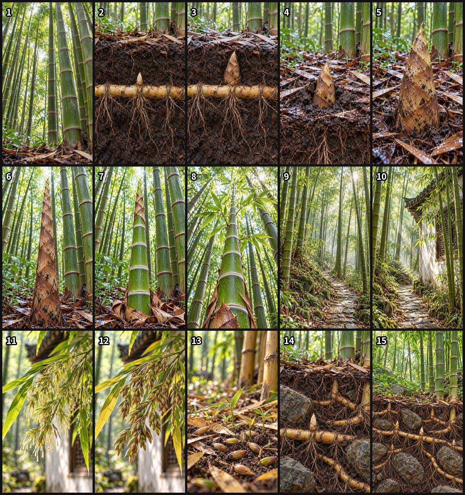

# 一镜到底：万物的一生

把一种植物或者动物的一辈子，拍成一个从头到尾不切的竖屏长镜头。竹鞭在土里横着走，笋芽鼓起来，一场春雨后破土，笋壳一片片落下，竹子拔节、成林、开花、结出竹米，最后回到地下的竹鞭。旁白是温柔的女声，每说到一个阶段的名字，屏幕中间出一个大字；隔几句插一句古诗，下面一行小字标出处。视频号和抖音上常见的那种「XX 的一生」自然科普片，这个 skill 从写稿到成片一条龙做出来。

另有一套「叫法」模板：一样东西一路变出十几个名字（水：洼、池、潭、渊、泉……洋；田：畦、垄、埂……），每说出一个名字，屏幕上换一个大字，镜头跟着大幅运动。3D 动画沙盘和写实航拍两种画风都能做。

它是给 Agent 用的 skill：DeepSeek Harness（dsh）、Claude Code、Codex 都行。装好以后跟 Agent 说一句话，它会照 `SKILL.md` 自己写稿、配音、画关键帧、出片、剪辑、审片，最后交成片和花费。

## 样片

竹子的一生，114 秒，14 段 H3 接成一个镜头。下面的动图是整条片子 6 倍速、没有声音，带声音的原片可以下载。


有声成片：[下载 mp4](docs/media/bamboo.mp4?raw=true)（720×1280，23 MB）

这条用的 15 张关键帧。第一张单独画，后面每张都在上一张图上改，只让竹子长一步或者镜头挪一下；相邻两张就是一段视频的首帧和尾帧，H3 补出中间的生长和运镜：



## 花多少钱、多少时间

竹子那条按账本算，走通一遍的第三方花费是 18.56 元：关键帧 15 张 6.37 元，H3 出 14 段 9.18 元，豆包整条配音一遍 2.40 元，配乐和审片 0.61 元。

我们第一次做的时候另外多花了 15.73 元，都是踩坑的钱。配音整条读了七遍，先试了三种语速，又为一个读错的「茎」字整条重读了四遍；H3 有一段钻进土里的镜头像被撕开，改了运镜写法又跑了两次。这些坑后来都写进了 skill：读错一个字只重读那一句，几分钱；哪段不行只重跑那一段，几毛钱。

时间上，从零开始调这个 skill，到复刻出效果不错的一条，我们花了一个小时。之后再做一条，最慢的是 H3：每段跑 3 到 7 分钟，各段同时提交，RunningHub 账号能同时跑几个任务，决定一共要等多久。

## 要哪些 key

三把 key，配乐那把可以不要：

| key | 用来做什么 | 去哪拿 |
| --- | --- | --- |
| `EVOLINK_API_KEY` | 豆包 Seed Audio 配旁白、GPT Image 2.5 画关键帧、Gemini 3.8 Flash 审片 | [Evolink](https://evolink.ai/signup?aff=wPdV)（推荐链接）控制台的 API Keys |
| `RUNNINGHUB_API_KEY` | MiniMax H3 首尾帧出片 | [RunningHub](https://www.runninghub.cn) 个人中心的「API 调用」 |
| `APIMART_API_KEY` | Suno v6 出纯音乐配乐，有现成配乐就不用 | [APIMart](https://apimart.ai/register?aff=J2lV)（推荐链接）控制台的令牌管理 |

逐字对时用本机的 Whisper（large-v3-turbo），不花钱。

## 装

要 Python 3.11 或更新。下面以 DeepSeek Harness 为例；用 Claude Code 就把 `~/.dsh/skills/` 换成 `~/.claude/skills/`，Codex 换成项目里的 `.agents/skills/`。

先装 dsh 本身（要 Node.js），打开它的网页界面，在「设置 → 模型」里填 DeepSeek 的 API key：

```bash
npm install -g @deepseek-ai/dsh
dsh web
```

再把这个 skill 克隆到 dsh 的 skill 目录，装依赖、配 key：

```bash
git clone https://github.com/garycaogan/gary-lifecycle-oneshot ~/.dsh/skills/lifecycle-oneshot
cd ~/.dsh/skills/lifecycle-oneshot
python3 -m venv .venv
.venv/bin/pip install -r requirements.txt
cp .env.example .env
```

用文本编辑器打开 `.env`，把 key 填在等号后面，再在自己的终端里自检一遍：

```bash
.venv/bin/python scripts/oneshot.py doctor --fetch-fonts --fetch-model
```

`doctor` 不花钱，查 Python、依赖、ffmpeg、首尾帧节点图和 key（不显示 key 本身）。第一次加的两个参数会下载约 73 MB 的开源字幕字体和约 1.6 GB 的转写模型。这一步要在自己的终端里跑：dsh 默认的「工作区内修改」只让 Agent 往工作区里写，它写不进 skill 文件夹和 `~/.cache`。全是 ✓ 就装好了，✗ 那行后面写着怎么补。国内连不上 Hugging Face 时，工具会自动改从 hf-mirror.com 下载。

懒得自己敲，也可以把仓库链接丢给 Agent，让它照 `references/setup.md` 装好。Mac 自带的 Python 太旧、Windows 上的命令怎么换，都在那页里。

## 一句话出片

装好以后，在 dsh 里新建会话，直接说一句话就行，中间不用再补步骤。下面四句都在 dsh 0.2.2-rc.5 + DeepSeek-V4.1-Flash 上，各自从一个空工作区实测跑通过（2026-11-27）：

| 说什么 | 做出来的 |
| --- | --- |
| 帮我复刻一条抖音百万赞的「水」的叫法一镜到底科普 | 照 `examples/water` 现成的剧本出片：洼→池→潭……→洋，3D 小水獭沙盘加航拍 |
| 帮我做一条「山」的叫法一镜到底科普，像抖音那条百万赞的「水」一样 | 自己写新名字链和新稿（丘、陵、冈、峰、岭……），画风按题材走写实航拍（点名要动画才用 3D 小主角） |
| 〈抖音视频链接〉 复刻这条 | 用自带的网页搜索查这条讲什么，定叫法还是一生、写实还是动画，再自己写稿出片 |
| 帮我做一条「一颗西瓜的一生」一镜到底科普 | 万物的一生：女声、古诗、写实微距，从种子长到结瓜再回到种子 |

每条从说完那句话到出片 40–72 分钟（大部分时间在等 H3），第三方花费 16.7–23.0 元，片长 90–103 秒，中间没有弹过一次审批卡。AI 会自己看检查结果、重跑不满意的段。

想先看稿子再花钱，就在那句话后面加「先给我看稿子和关键帧」。

## 一条片子怎么做出来

一条片子一个项目文件夹，里面一份 `film.json` 是唯一的剧本（格式见 `references/film-format.md`，完整范例是 `examples/bamboo/film.json`）。然后按顺序跑：

```bash
.venv/bin/python scripts/oneshot.py write     --project ~/oneshot/wheat   # 列出多音字和生僻字，不花钱
.venv/bin/python scripts/oneshot.py voice     --project ~/oneshot/wheat   # 豆包一次读完整条，Whisper 逐字对时
.venv/bin/python scripts/oneshot.py keyframes --project ~/oneshot/wheat   # 关键帧一张接一张改出来
.venv/bin/python scripts/oneshot.py plan      --project ~/oneshot/wheat   # 按旁白算每段的起止
.venv/bin/python scripts/oneshot.py h3        --project ~/oneshot/wheat --dry-run   # 先看提示词，不花钱
.venv/bin/python scripts/oneshot.py h3        --project ~/oneshot/wheat   # 各段同时出片
.venv/bin/python scripts/oneshot.py music     --project ~/oneshot/wheat
.venv/bin/python scripts/oneshot.py captions  --project ~/oneshot/wheat
.venv/bin/python scripts/oneshot.py cut       --project ~/oneshot/wheat
.venv/bin/python scripts/oneshot.py check     --project ~/oneshot/wheat
.venv/bin/python scripts/oneshot.py cost      --project ~/oneshot/wheat
```

几处我们试出来的做法：

- **首尾帧，不是参考图。** RunningHub 上 YZ金鱼 的「MiniMax H3 终极篇」工作流用的是参考图生视频，只会「参考」图，不会从图 1 开始、停在图 2。我们把那个节点换成了 ComfyUI 官方的首尾帧节点，提示词第一行写 MiniMax 官方的对齐句。竹子那条每段第一帧和最后一帧跟给定关键帧的相似度（SSIM）在 0.82 到 0.95 之间，两张关键帧互相之间只有 0.05 到 0.72，说明首尾帧真的生效了。
- **关键帧链式编辑。** 每张都单独画，H3 只能在两个场景之间硬变形；每张在上一张上改，相邻两张只差一步，H3 补出来的就是生长和运镜。
- **接缝处要缓起。** 段和段之间跳的不是画面，是速度：前一段在关键帧那里慢慢停下，后一段常常一开头就全速运镜。工具量每段开头的运动量，猛的段自动加 0.8 秒缓起再叠化。
- **整条配音、只重读一句。** 整条一次读，语气才连得上；哪句读错，`fixline` 只重读那一句接回原位。Whisper 听不出声调，可疑的字用 `tone` 量音高。
- **三种字分区。** 古诗在上、名字大字在中上、旁白短句在下三分之一，都在视频号和抖音的安全区里，工具会检查同一时刻的字有没有叠在一起。字幕有墨韵、金书、宋韵三套样式，都是 SIL OFL 的开源字体。

每一步的细节和踩过的坑都在 `SKILL.md`，稿子怎么写、关键帧怎么画、首尾帧提示词怎么写在 `references/method.md`。

## 验证到哪一步

上面四句在 Apple 芯片的 Mac 上，用 DeepSeek Harness 0.2.2-rc.5 和 DeepSeek-V4.1-Flash 从空工作区各跑通过一遍；竹子那条更早也从写稿到成片做过。Claude Code 和别的模型没逐条跑；Windows、Linux 上转写换成 faster-whisper，代码支持，但没实测。离线测试不联网、不要 key：

```bash
python -m unittest discover -s tests -v
```

## 许可

代码、文档和提示词是 MIT。`workflows/h3-ultimate-fl.json` 改自 RunningHub 用户 YZ金鱼 公开的工作流[「MiniMax H3 终极篇-文武双全」](https://www.runninghub.cn/post/2109907990638850050)，版权归原作者，改了哪几处写在 `workflows/README.md`；MiniMax H3 模型遵守 [MiniMax H3 Community License](https://huggingface.co/MiniMaxAI/MiniMax-H3/blob/main/LICENSE)。`fonts/` 里的字体都是 SIL Open Font License 1.1，授权文件跟着字体放。

用 H3 照分镜出整条剧情片，看姊妹仓库 [h3-ref-video](https://github.com/garycaogan/gary-h3-ref-video)；照着原片换人翻拍，看 [mv-swap](https://github.com/garycaogan/gary-mv-swap)。
